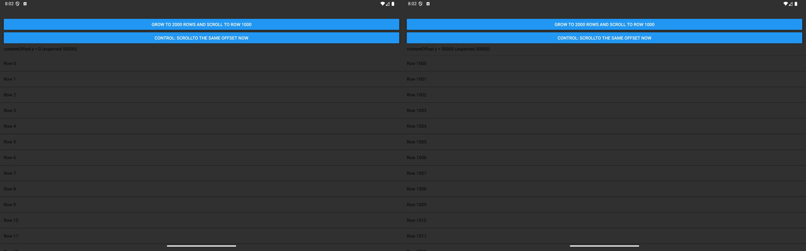
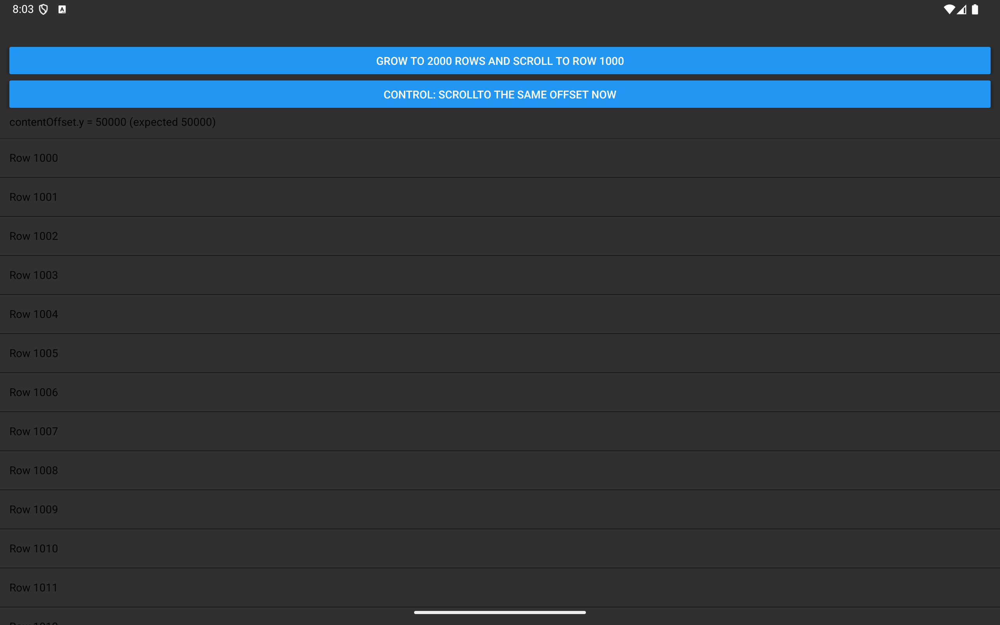

# Android: scrollTo from a layout effect is clamped to the previous content size

Minimal reproducer for React Native 0.86.2 with the New Architecture on Android.

On Android, a `ScrollView.scrollTo` sent from `useLayoutEffect` in the same commit that makes the content taller doesn't scroll. The ScrollView stays at 0. The same `scrollTo` works once the taller content is mounted.

## Run

```sh
npm install
npx react-native run-android
```

## Steps

1. Tap **Grow to 2000 rows and scroll to row 1000**. The list grows to 2000 rows, but stays at row 0: `contentOffset.y = 0`.
2. Tap **Control: scrollTo the same offset now**. The same `scrollTo` lands on row 1000: `contentOffset.y = 50000`.

The code is in [`App.tsx`](App.tsx).



## With `disableEarlyViewCommandExecution`

Forcing the `disableEarlyViewCommandExecution` feature flag on fixes it: **Grow** lands on row 1000 by itself. Add this after `loadReactNative(this)` in `MainApplication.kt`:

```kotlin
com.facebook.react.internal.featureflags.ReactNativeFeatureFlags.dangerouslyForceOverride(
    object : com.facebook.react.internal.featureflags.ReactNativeNewArchitectureFeatureFlagsDefaults() {
      override fun disableEarlyViewCommandExecution(): Boolean = true
    })
```



## Tested on

- React Native 0.86.2, fresh `@react-native-community/cli init` app
- Android 16 (API 36), Pixel Tablet emulator
